

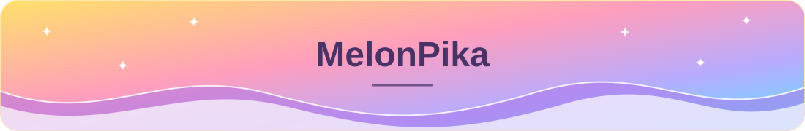

  <picture>
    <source media="(prefers-color-scheme: dark)" srcset="assets/profile/typing-dark.svg" />
    
  </picture>

  <a href="https://github.com/MelonPika?tab=repositories">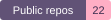</a>
  <a href="https://github.com/MelonPika?tab=followers">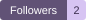</a>
  <a href="https://github.com/MelonPika?tab=stars">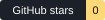</a>

<h2 align="center">🌙 <samp>MelonPika's Cozy Corner · 蜜瓜小窝</samp> 🐾</h2>

<table align="center" width="100%">
  <tr>
    <td align="center" valign="middle" width="28%">
      
       
      <strong><samp>🍈 MelonPika</samp></strong>
       
      <em>🌙 Little ideas, pastel skies ✨</em> <samp>(ᵔᴥᵔ)</samp>
    </td>
    <td valign="top" width="72%">
      
 👋 Hi, I'm <strong><samp>MelonPika</samp></strong> 🍈 <samp>(｡･ω･｡)ﾉ</samp> 
      A little space for my public projects, experiments, and things I’m exploring. 
      📍 <samp>[Add location · optional]</samp> · <samp>[Add your bio]</samp>

      
<strong>🍡 Coding Languages</strong> 
        <a href="https://www.python.org/">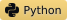</a>
        <a href="https://www.typescriptlang.org/">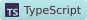</a>
        <a href="https://developer.mozilla.org/en-US/docs/Web/JavaScript">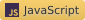</a>
        <a href="https://vuejs.org/">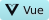</a>
         Languages and frameworks found in my public repositories, including forks.
      

      
<strong>🎨 Creative Toolbox</strong> 
        <a href="https://git-scm.com/">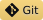</a>
        <a href="https://github.com/MelonPika">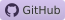</a>
         <samp>[Add your creative tools &amp; software]</samp>
      

      
<strong>💌 Come Say Hello</strong> 
        <a href="https://github.com/MelonPika">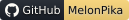</a>
         <samp>[Add verified social &amp; contact links]</samp>
      

    </td>
  </tr>
</table>

<h2 align="center">🏅 <samp>Learning &amp; Badges (｡･ω･｡)ﾉ</samp></h2>

<h3 align="center">IBM SkillsBuild · 2 verified badges</h3>

<table align="center" width="100%">
  <tr>
    <td align="center" valign="top" width="50%">
      <a href="https://www.credly.com/badges/12fc77c7-082f-4446-ae12-36fa75eeabdc/public_url">
        
         <strong>User Experience Design Fundamentals</strong>
      </a>
       IBM-SkillsBuild Issued Jul 19, 2026
    </td>
    <td align="center" valign="top" width="50%">
      <a href="https://www.credly.com/badges/cf26e096-224f-494f-b1dd-d2f0ffde20d9/public_url">
        
         <strong>Web Development Fundamentals</strong>
      </a>
       IBM-SkillsBuild Issued Jul 17, 2026
    </td>
  </tr>
</table>

Click a badge to view its public Credly verification record.

<a href="https://me.developers.google.com/u/106734451394183812167">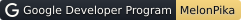</a> · <samp>[Add Microsoft Learn profile]</samp> All four Google badges link to my public profile. Microsoft Learn entries are placeholders for future achievements.

<h3 align="center">Google Developer Program · 4 verified badges</h3>

<table align="center" width="100%">
  <tr>
    <td align="center" valign="top" width="50%">
      <a href="https://me.developers.google.com/u/106734451394183812167">
        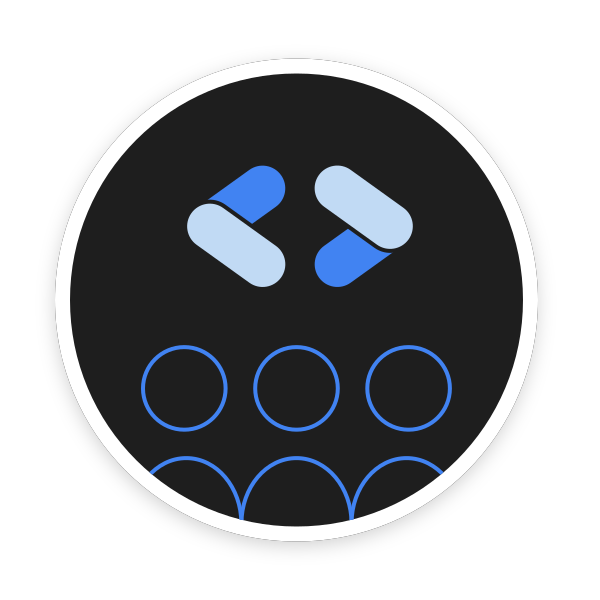
         <strong>Google Developer Group discovery</strong>
      </a>
       Google Developer Program Earned Oct 24, 2026
    </td>
    <td align="center" valign="top" width="50%">
      <a href="https://me.developers.google.com/u/106734451394183812167">
        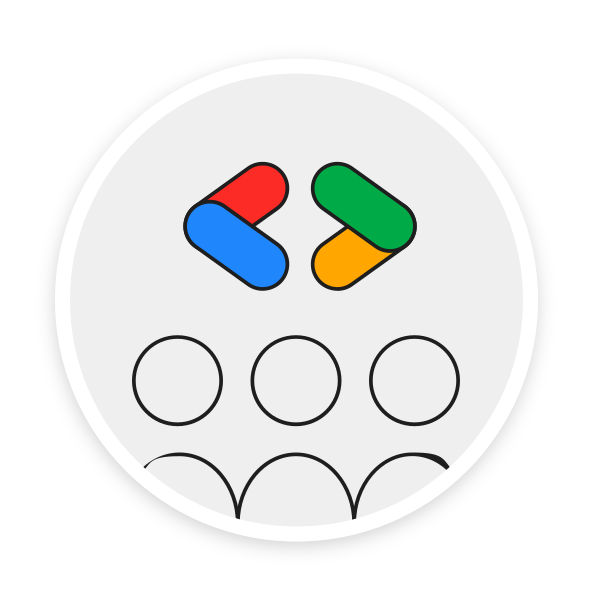
         <strong>Google Developer Group on Campus member</strong>
      </a>
       Google Developer Program Earned Oct 24, 2026
    </td>
  </tr>
  <tr>
    <td align="center" valign="top" width="50%">
      <a href="https://me.developers.google.com/u/106734451394183812167">
        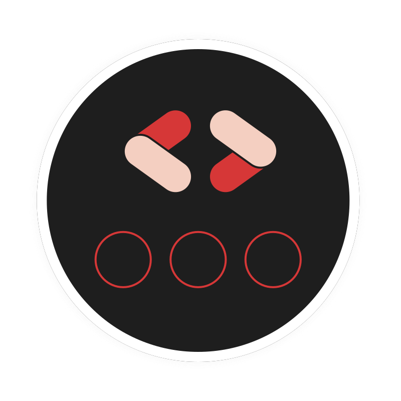
         <strong>GDG on Campus Nanyang Polytechnic - Singapore, Singapore Member</strong>
      </a>
       Google Developer Program Earned Oct 24, 2026
    </td>
    <td align="center" valign="top" width="50%">
      <a href="https://me.developers.google.com/u/106734451394183812167">
        
         <strong>Joined the Google Developer Program</strong>
      </a>
       Google Developer Program Joined Oct 24, 2026
    </td>
  </tr>
</table>

<h3 align="center">Microsoft Learn · [Add verified achievements]</h3>

<table align="center" width="100%">
  <tr>
    <td align="center" width="33%"> <strong>[Add module badge]</strong></td>
    <td align="center" width="33%"> <strong>[Add module badge]</strong></td>
    <td align="center" width="33%"> <strong>[Add module badge]</strong></td>
  </tr>
  <tr>
    <td align="center" width="33%"> <strong>[Add path trophy]</strong></td>
    <td align="center" width="33%"> <strong>[Add path trophy]</strong></td>
    <td align="center" width="33%"> <strong>[Add module badge]</strong></td>
  </tr>
</table>

<!-- BEGIN featured-repositories -->
<h2>✨ <samp>Featured Repositories (ง •̀_•́)ง</samp></h2>

  <a href="https://github.com/MelonPika/NYP"><picture><source media="(prefers-color-scheme: dark)" srcset="assets/profile/repositories/repo-1-dark.svg" />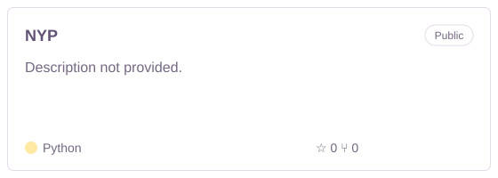</picture></a>

<!-- END featured-repositories -->

<h2 align="center">📊 <samp>GitHub Stats (＾▽＾)</samp></h2>

  <picture>
    <source media="(prefers-color-scheme: dark)" srcset="assets/profile/stats-overview-dark.svg" />
    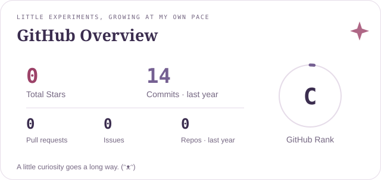
  </picture>

  <picture>
    <source media="(prefers-color-scheme: dark)" srcset="assets/profile/stats-streak-dark.svg" />
    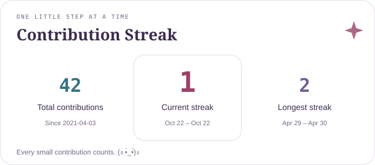
  </picture>

  <picture>
    <source media="(prefers-color-scheme: dark)" srcset="assets/profile/languages-dark.svg" />
    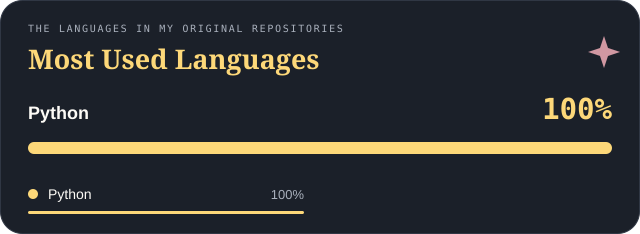
  </picture>

<h2 align="center">🌱 <samp>Activity Graph</samp></h2>

  <picture>
    <source media="(prefers-color-scheme: dark)" srcset="assets/profile/activity.svg" />
    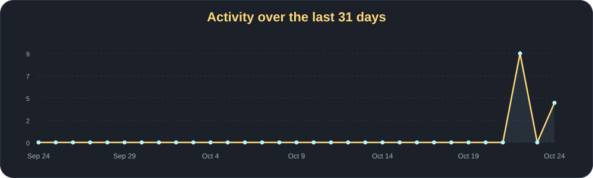
  </picture>

<h2 align="center">🐍 <samp>Contribution Snake</samp></h2>

  <picture>
    <source media="(prefers-color-scheme: dark)" srcset="assets/profile/github-snake-dark.svg" />
    <source media="(prefers-color-scheme: light)" srcset="assets/profile/github-snake.svg" />
    
  </picture>

<h2 align="center">🌌 <samp>3D Contributions (☆▽☆)</samp></h2>

  <picture>
    <source media="(prefers-color-scheme: dark)" srcset="assets/profile/3d-contributions-dark.svg" />
    <source media="(prefers-color-scheme: light)" srcset="assets/profile/3d-contributions-light.svg" />
    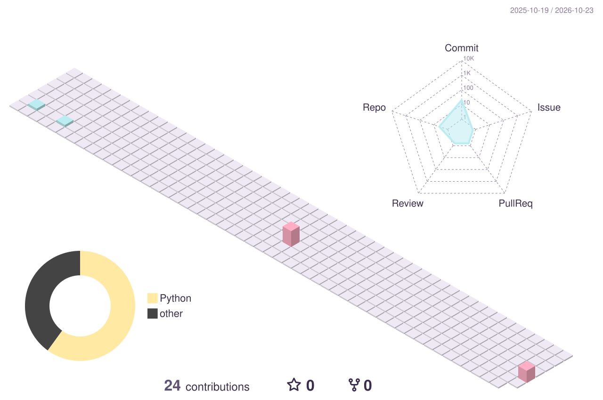
  </picture>

Visual inspiration: <a href="https://github.com/ShadowsLunarfox/ShadowsLunarfox">ShadowsLunarfox's cozy profile</a> · <a href=".github/THIRD_PARTY_NOTICES.md">Credits</a>

